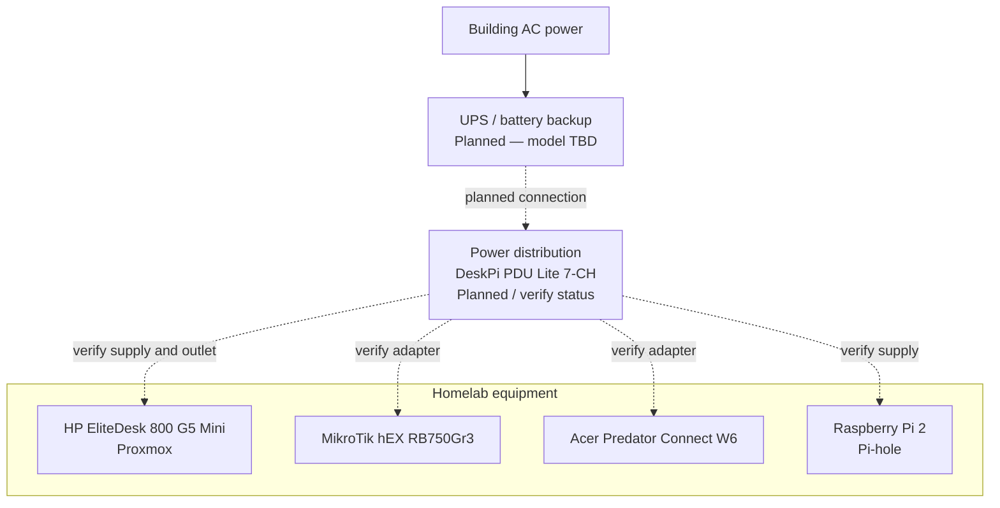
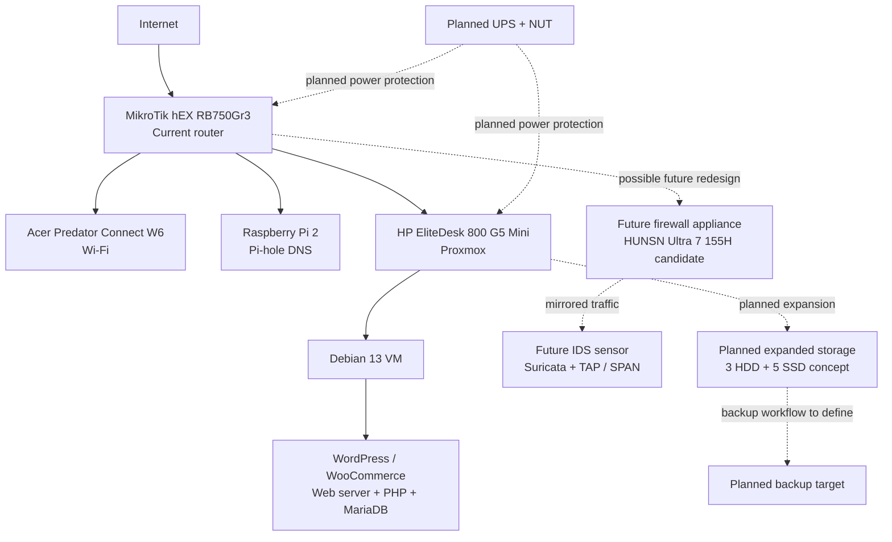

# Homelab Hardware, Power & Roadmap

A living inventory and build plan for my self-hosted homelab. This README brings
the physical hardware, power infrastructure, current services, and planned
expansion into one place.

> **Status key**
> - **In service** — confirmed as part of the working environment.
> - **Owned / used** — hardware used for administration or the lab, but not
>   necessarily an always-on server.
> - **Planned** — intended addition or an active design direction; not confirmed
>   as purchased or installed.
> - **Under consideration** — researched as an option; final selection not made.
> - **To verify** — previously mentioned, but exact model, configuration, or
>   current status needs checking.
>
> This is a working inventory assembled from the build notes. A mention in the
> planned sections does not mean the item has been purchased.

## 1. Project goals

- Build and maintain a reliable, self-hosted infrastructure environment.
- Learn Linux administration, networking, virtualization, storage, security,
  automation, and infrastructure operations through practical projects.
- Run services on hardware I control rather than relying entirely on managed
  hosting.
- Improve resilience through sensible power distribution, backups, monitoring,
  and documented recovery procedures.
- Keep the architecture modular so that additional services and hardware can
  be introduced without rebuilding everything.

## 2. Current hardware inventory

### Compute and administration

| Hardware | Role | Status | Notes |
|---|---|---|---|
| HP EliteDesk 800 G5 Mini | Main Proxmox virtualization host | **In service** | Also referred to in earlier notes as the HP EliteDesk G5. Confirm exact sub-model and CPU/RAM configuration. |
| Lenovo ThinkPad T480s | Linux workstation / network and server administration | **Owned / used** | Used for Linux learning and homelab administration. |
| MacBook Air (M4, 16 GB) | Secondary workstation and administration | **Owned / used** | Used for device management and other personal workflows. |

### Networking

| Hardware | Role | Status | Notes |
|---|---|---|---|
| MikroTik hEX RB750Gr3 | Main router; routing, DHCP and NAT | **In service** | Previously documented at `192.168.88.1`. |
| Acer Predator Connect W6 | Wi-Fi access point / wireless network equipment | **In service** | The exact division of routing and access-point duties should be reflected in the final network diagram. |
| Raspberry Pi 2 | Pi-hole DNS filtering | **In service** | Previously documented as the Pi-hole host. Exact current IP should be verified before publishing. |

### Storage

| Hardware | Role | Status | Notes |
|---|---|---|---|
| Multiple HDDs | Bulk / backup storage | **Owned / used — details to verify** | Exact models, capacities, health, and current attachment method have not been captured in this inventory. |
| Multiple SSDs | Fast storage / possible service and VM storage | **Owned / used — details to verify** | Exact models, capacities, and interface types need to be recorded. |
| KIOXIA KBG40ZNV256G (238.5 GB) NVMe | Proxmox boot / local storage device | **Previously identified; verify current use** | Earlier host storage notes identified this NVMe as `nvme0n1`, with LVM root, data, and swap volumes. |

## 3. Current software and services

These are included to explain what the hardware supports; this is not a software
installation guide.

| Service / platform | Hardware location | Status / purpose |
|---|---|---|
| Proxmox VE | HP EliteDesk 800 G5 Mini | **In service** — virtualization platform. |
| Debian GNU/Linux 13 (Trixie) | Proxmox virtual machine | **In service** — Linux server VM. |
| Nginx | Debian VM | **In service / current web-server configuration** — confirm against the live VM before documenting a final deployment diagram. |
| WordPress + WooCommerce | Debian VM | **In development** — self-hosted ecommerce platform for Katto & Co. |
| MariaDB + PHP | Debian VM | **In service / required by the WordPress application** — exact PHP-FPM configuration should be verified. |
| Pi-hole | Raspberry Pi 2 | **In service** — network DNS filtering. |
| Tailscale | Homelab access | **Used / configuration to verify** — remote access has been tested. |

The WordPress application has previously been documented as a Debian VM running
a web server, PHP, and MariaDB. Earlier architecture drafts used Apache while
the current host configuration has used Nginx. Keep diagrams aligned with the
actual deployed configuration rather than treating both as simultaneously
installed.

## 4. Power infrastructure

The power design is intended to make the lab safer, easier to service, and more
resilient during short outages. The distinction between installed and proposed
equipment is important.

### Power equipment inventory

| Hardware / system | Purpose | Status | Details |
|---|---|---|---|
| HP EliteDesk power adapter | Supplies the Proxmox host | **To verify** | Previously recorded as 19 V, 3.3 A (about 62.7 W maximum rated output). Confirm the physical adapter label. |
| DeskPi PDU Lite 7-CH | Organized multi-channel power distribution | **Planned / status to verify** | Discussed for a 10-inch rack power layout. Confirm exact revision, input, output types, and channel limits. |
| Mean Well LRS-200-24 | 24 V DC power supply | **Planned / status to verify** | Discussed as a possible centralized DC supply. It is a 24 V supply, not a direct replacement for the EliteDesk's 19 V adapter. |
| UPS / battery backup | Ride through short power interruptions | **Planned** | Exact make, model, VA/W rating, battery condition, and runtime not yet recorded. |
| Network UPS Tools (NUT) | UPS monitoring and coordinated shutdown | **Planned** | Select and configure only after confirming UPS model and communication interface. |
| WoNUT | UPS status / monitoring interface | **Under consideration** | Exact project and deployment choice to be confirmed. |
| Plug-in power meter | Measure real equipment consumption | **Planned / recommended measurement task** | Use readings to size UPS and power distribution rather than relying on estimates. |

### Power architecture

This is a conceptual diagram, not a verified wiring schematic. Dashed
connections indicate proposed distribution that must be checked against the
actual installed equipment.

### Power design notes

- The EliteDesk adapter was previously noted as **19 V / 3.3 A**. Verify the
  label before using this value in any design or calculation.
- The Mean Well LRS-200-24 provides **24 V DC**. Do not connect the EliteDesk
  directly to 24 V; its previously noted adapter is 19 V.
- A DC supply is not a universal replacement for device-specific adapters.
  Confirm voltage, polarity, connector, current capacity, grounding, and
  protection for every load.
- Confirm the PDU's total rating and per-channel limits before connecting
  equipment.
- Record actual idle and load watts for each device before choosing UPS size.
- Decide which devices must remain online during an outage. Network equipment
  and DNS may have different shutdown priorities from the Proxmox host.
- Plan graceful Proxmox shutdown and recovery behavior before relying on a UPS.

### UPS and shutdown roadmap

1. Select a UPS based on measured load, desired runtime, and shutdown needs.
2. Confirm whether the UPS supports NUT and identify the correct driver.
3. Decide which devices use battery-backed outlets and which use surge-only
   outlets.
4. Configure monitoring and a safe shutdown threshold.
5. Test the shutdown path and recovery process using the manufacturer's
   supported test procedure.
6. Record measured runtime under normal homelab load.

### Electrical safety

- Treat mains-voltage wiring as hazardous; do not modify mains equipment unless
  qualified.
- Use properly rated cables, connectors, fuses, enclosures, and strain relief.
- Verify DC voltage and polarity with a meter before connecting a device.
- Do not exceed power-supply, PDU, cable, or outlet ratings.
- Provide ventilation for power supplies and UPS equipment.
- Do not infer electrical compatibility from a connector fitting.

## 5. Planned hardware additions

These are the main hardware directions discussed for expanding the lab. Exact
models and purchase status should be updated as decisions are finalized.

### Networking and security

| Planned hardware | Intended role | Status / decision notes |
|---|---|---|
| HUNSN firewall / network appliance — Intel Core Ultra 7 155H, 4 × 2.5 GbE Intel I226-V, 8 GB RAM, 128 GB storage (configuration discussed) | Dedicated routing, firewalling, segmentation, and network services platform | **Under consideration / grant candidate**. Confirm exact vendor SKU, RAM/storage upgradeability, NIC chipset, and power draw before purchase. |
| Network TAP or managed switch with port mirroring (SPAN) | Feed network traffic to a monitoring / IDS sensor | **Under consideration**. A TAP is useful when there is a clear monitoring objective and a sensor to receive the traffic; it is not a prerequisite for a beginner lab. |
| Dedicated network monitoring / IDS sensor hardware | Run tools such as Suricata against mirrored traffic | **Planned concept**. Could be a repurposed system or dedicated appliance; hardware selection not finalized. |
| Network cable tester / troubleshooting kit | Verify Ethernet cabling and troubleshoot physical-layer issues | **Planned / tool selection open**. Choose based on whether the goal is basic wire mapping, PoE testing, or certification-level cable testing. |
| Additional managed switching | VLANs and better separation of lab networks | **Planned**. Exact switch model and port count not finalized. |

### Storage and rack

| Planned hardware | Intended role | Status / decision notes |
|---|---|---|
| 10-inch rack | Centralize and organize small homelab equipment | **Planned / in progress**. |
| 3-HDD + 5-SSD storage arrangement | Expand local storage and separate workloads / backups | **Planned design**. Exact drives, enclosure, controller, cooling, and filesystem not finalized. |
| 3D-printed drive bay / mounting system | Physically mount three HDDs and five SSDs | **Planned concept**. Validate airflow, vibration, drive temperature, and serviceability. |
| Additional backup storage | Keep backups separate from primary VM / application storage | **Planned**. Define backup capacity and retention before selecting hardware. |

### Power and reliability

| Planned hardware | Intended role | Status / decision notes |
|---|---|---|
| UPS | Battery backup for compute and network equipment | **Planned**. Size from measured watts and desired runtime. |
| DeskPi PDU Lite 7-CH | Rack power distribution | **Planned / status to verify**. |
| Mean Well LRS-200-24 | Centralized 24 V DC power source for compatible loads | **Planned / status to verify**. Requires correctly engineered distribution, fusing, connectors, and any needed DC-DC conversion. |
| DC-DC converters (as required) | Provide device-specific DC voltages from a centralized supply | **Under consideration**. Only use after calculating load and verifying electrical requirements. |
| Fused DC distribution and suitable enclosure | Protect and organize any low-voltage DC distribution | **Planned if centralized DC power is implemented**. |
| UPS monitoring interface / NUT host integration | Monitoring and automated shutdown | **Planned**. |

## 6. Network and infrastructure roadmap

The longer-term direction is to grow the lab into a segmented, monitored,
automated infrastructure environment.

### Network segmentation

Planned VLAN / network separation:

- **Management** — hypervisor and network-device administration.
- **Servers and storage** — VMs, containers, and storage services.
- **Trusted clients** — personal computers and trusted devices.
- **IoT** — less-trusted smart devices.
- **Guest** — isolated guest access.

The exact VLAN IDs, subnet ranges, firewall rules, and switch ports should be
documented only after implementation. Do not publish credentials or sensitive
network details.

### Security and monitoring

- Explore Suricata for network intrusion detection.
- Use a TAP or SPAN source only when the sensor placement and traffic visibility
  are understood.
- Add centralized monitoring and alerting as the number of services grows.
- Document firewall rules and network changes.
- Keep management interfaces restricted to trusted networks.

### Virtualization and automation

- Continue expanding Proxmox services in a controlled way.
- Evaluate Docker / container workloads where appropriate.
- Learn Ansible for repeatable host and service configuration.
- Treat Kubernetes as a longer-term learning goal, not a requirement for the
  current production-like services.
- Document backup, restore, and disaster-recovery procedures.

### Self-hosted ecommerce

- Continue developing the Katto & Co WordPress / WooCommerce deployment.
- Keep the web application separated from network infrastructure services.
- Maintain backups on separate storage.
- Use Cloudflare as an edge / DNS / access layer where appropriate; do not
  describe it as a replacement for local backups or a guaranteed server failover
  system unless a real failover design is implemented and tested.

## 7. Current and future architecture at a glance

## 8. Open questions and verification checklist

### Inventory

- [ ] Confirm exact EliteDesk 800 G5 Mini CPU, RAM, and model variant.
- [ ] Confirm current Proxmox version and host storage layout.
- [ ] Record exact HDD and SSD models, capacities, interfaces, and health.
- [ ] Confirm the current Raspberry Pi model and Pi-hole IP.
- [ ] Confirm the current role and mode of the Acer W6.

### Power

- [ ] Verify the EliteDesk adapter label (previously noted as 19 V, 3.3 A).
- [ ] Record adapter specifications for router, W6, and Pi-hole.
- [ ] Confirm whether the DeskPi PDU Lite 7-CH is owned or still planned.
- [ ] Confirm whether the Mean Well LRS-200-24 is owned or still planned.
- [ ] Select and document UPS make/model and battery condition.
- [ ] Measure device idle and typical load watts.
- [ ] Document actual outlet assignments and cable paths.

### Future hardware

- [ ] Finalize whether to pursue the HUNSN 2.5 GbE appliance.
- [ ] Decide whether a TAP or SPAN-capable switch best fits the monitoring goal.
- [ ] Select the IDS sensor platform.
- [ ] Finalize the 10-inch rack and storage mounting design.
- [ ] Choose storage drives, controller, filesystem, and backup approach.
- [ ] Define VLANs and firewall policy before moving devices between networks.

## 9. Change log

Add a dated entry whenever hardware is purchased, installed, removed, or
reconfigured.
