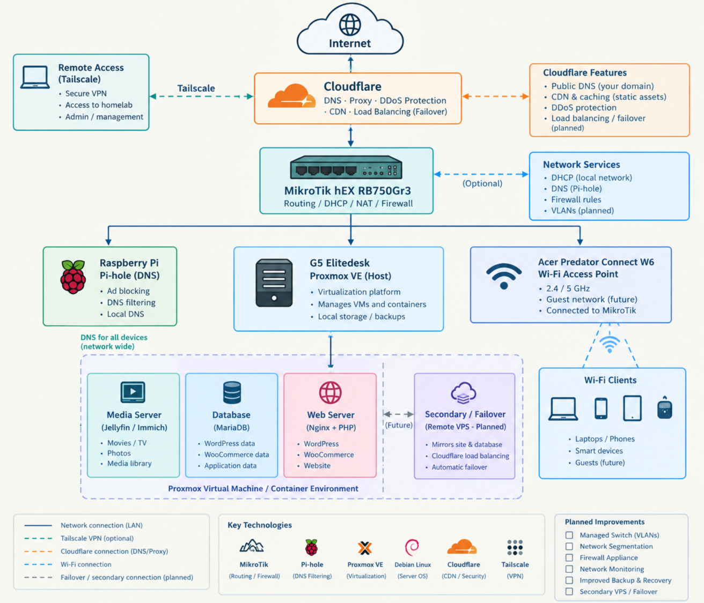

# Linux Homelab

## Self-Hosted Infrastructure, Linux Administration & Networking

This repository documents the design, configuration, maintenance, and ongoing development of my personal homelab. Everything from my personal network/media to my self hosted E-commerce website. With the intent to help other with zero experience and have transperency with the our information. 

Built around Proxmox, Debian Linux, and MikroTik networking, this environment serves as a practical learning platform for Linux administration, network engineering, virtualization, and self-hosted services.

The goal is to build a reliable, understandable, and maintainable infrastructure environment while documenting the decisions, configurations, challenges, and lessons learned along the way.

⸻

## Infrastructure Overview

My homelab combines network infrastructure, virtualization, Linux servers, and self-hosted applications.

| Component | Technology | Purpose |
|-|-|-|
| Virtualization | Proxmox VE | Hosts virtual machines and server workloads |
| Network routing | MikroTik hEX RB750Gr3 | Routes traffic between the local network and internet |
| DNS filtering | Pi-hole | Provides network-level DNS filtering |
| Server operating system | Debian Linux | Runs self-hosted applications |
| Web server | Nginx | Serves the WordPress website |
| Database | MariaDB | Stores application data |
| E-commerce | WordPress and WooCommerce | Powers the Katto & Co. website |

The implementation and configuration of individual components are documented in their respective project directories.

## Homelab Architecture

The diagram below illustrates the current homelab infrastructure,

including network routing, virtualization, self-hosted services,

and planned remote failover.

The architecture is still being refined. Some components have been deployed independently while the final routing, DHCP, and Wi-Fi architecture is being completed.

## Hardware

| Device | Role | Status |
|---|---|---|
| HP EliteDesk 800 G5 | Proxmox Host | Active |
| MikroTik hEX RB750Gr3 | Router | Active |
| Raspberry Pi | Pi-hole DNS | Active |
| Acer W6 | Wi-Fi | Active |

## Major Projects

Explore the Projects

### Networking

Documentation covering network topology, MikroTik configuration, DNS filtering, and planned network improvements.

Directory: [Networking](/networking/README.md)  

### Virtualization

Documentation covering Proxmox and the virtualized infrastructure supporting the homelab.

Directory: virtualization/

### Linux Administration

Documentation covering Debian server configuration, system administration, and troubleshooting.

Directory: linux/

### Personal Self-Hosted Services

Documentation covering the installation, architecture, operation, and maintenance of services running on the homelab.

Directory: [Services](PersonalServer/Steaming.md)

### Security & Privacy

Documentation covering security practices, privacy principles, and improvements to infrastructure reliability.

Directory: security-privacy/

## Engineering Principles

This project follows several principles:

* Document the implementation: Explain how systems are configured and why particular decisions were made.
* Prefer maintainability: Favor understandable configurations and repeatable procedures.
* Design for recovery: Document backups, troubleshooting, and recovery procedures as they are implemented.
* Protect sensitive information: Never intentionally publish credentials, private keys, customer information, or sensitive infrastructure details.
* Improve iteratively: Separate implemented features from planned improvements.
* Learn through practical work: Record the problems encountered and the steps used to resolve them.

## Troubleshooting

A major part of this project is documenting failures and the investigation process.

Examples include:

* Slow networking after introducing the MikroTik
* Multiple network routes on Linux
* Pi-hole connectivity problems
* DHCP architecture conflicts
* SSH connectivity issues
* Hardware expansion limitations

Troubleshooting documentation →⁠

⸻

## Current Development

The homelab is an evolving project. Current and planned improvements include network segmentation, stronger monitoring, more robust backup and recovery procedures, and continued development of self-hosted services.

See docs/roadmap.md for the development plan.

⸻

## Why This Project Exists

This project began as a personal Linux and infrastructure learning environment.

Rather than learning infrastructure entirely through tutorials, I am using physical hardware to build, break, troubleshoot, document, and improve a functioning environment.

The long-term goal is to develop practical skills that can be transferred into infrastructure and DevOps roles.

⸻

Author

Jorden St. John

Doing my best to control and understand our data in the modern world. 
